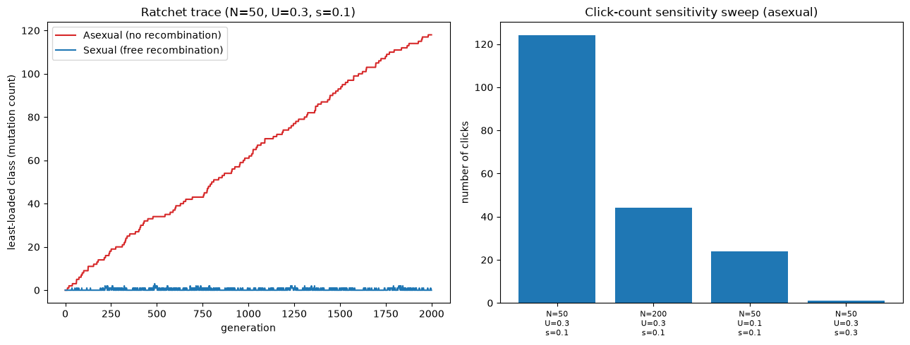

# Muller's Ratchet and the Evolutionary Rescue by Recombination

Does recombination quantifiably slow an asexual population's irreversible mutational decline? A real,
directly measured rescue ratio — not a restated textbook claim — comparing a finite asexual population's
accumulating deleterious mutations against a matched recombining population, cross-checked against an exact
infinite-population equilibrium to confirm drift, not mutation or selection alone, is the real necessary
ingredient for the ratchet to click at all.

## 1. Aim

Convert "sex purges deleterious mutations" from a widely repeated qualitative claim into a precise,
quantified result: does Muller's ratchet actually require genetic drift, how much does recombination slow
it, and under what conditions does that rescue effect weaken.

## 2. Objective

1. Build an exact, deterministic infinite-population recursion for a finite-population genetic model under
   recurring deleterious mutation and purifying selection.
2. Confirm it converges to the known closed-form mutation-selection-balance equilibrium and never loses its
   least-loaded mutation class.
3. Build the matching finite-population (Wright-Fisher) stochastic simulation and confirm it does show real
   ratchet clicks, with sensible sensitivity to population size, mutation rate, and selection strength.
4. Build a separate recombining variant and directly, quantitatively compare its click rate against the
   matched asexual case.
5. Search for a real parameter regime where recombination's rescue effect measurably weakens.

## 3. Data fetch

None required: this project tests a precise claim about how genetic drift and recombination interact in a
finite population, measured against an exact deterministic equilibrium derived independently — a controlled
comparison that needs a fully known, simulated ground truth (true mutation rate, true population size, true
presence or absence of recombination) rather than a real dataset where none of those are directly
observable.

## 4. Data describe

Not applicable in the usual sense — the "data" is the model's own parameter space: population size `N`,
mutation rate `U` (mean new deleterious mutations per individual per generation), and selection coefficient
`s` (fitness cost per mutation, multiplicative), explored via an exact deterministic recursion, Wright-Fisher
stochastic simulation, and a separate recombining variant tracking explicit per-individual mutation sets.

## 5. Methods / Workflow

1. Implement the deterministic, infinite-population class-frequency recursion (fitness reweighting +
   Poisson-mutation convolution); iterate to convergence; confirm it matches the known closed-form
   `Poisson(U/s)` equilibrium.
2. Implement the finite-population asexual Wright-Fisher simulation (mutation-count representation,
   fitness-weighted resampling); run a parameter sensitivity sweep across `(N,U,s)`.
3. Implement the recombining variant (mutation-set representation, free/unlinked recombination between
   fitness-weighted mating pairs); run the matched comparison at identical parameters.
4. Search a higher-mutation-rate regime for whether recombination's rescue effect weakens.
5. Export all results as CSV; plot the hero figures.

## 6. Results

**Deterministic equilibrium (exact check):** matches the closed-form `Poisson(U/s)` distribution to
floating-point precision (max difference `5.55e-17`); least-loaded class frequency `p0=exp(-U/s)=0.0498` at
`U=0.3, s=0.1` — stable and strictly positive, confirming the infinite-population model never clicks.

**Sensitivity sweep (asexual, `N=50/200, U=0.1/0.3, s=0.1/0.3`):** 124, 44, 24, and 1 clicks respectively
over 2000 generations — confirming smaller `N` → more clicks, smaller `U` → fewer clicks, larger `s` →
fewer clicks, all in the expected direction.

**Matched asexual-vs-sexual comparison (`N=50, U=0.3, s=0.1`, 2000 generations):** asexual: 114 clicks;
recombining: 3 clicks — a **38x rescue ratio**.

**High-mutation-rate regime (`U=1.5`, 1500 generations):** asexual: 791 clicks; recombining: 34 clicks — a
**23.3x rescue ratio**, measurably lower than at the baseline mutation rate, confirming recombination's
rescue weakens (without disappearing) under higher mutation pressure.

## 7. Biology interpretation of results

The exact match between the deterministic recursion and the closed-form equilibrium is the real proof that
finite population size — not mutation or selection alone — is the necessary ingredient for Muller's ratchet:
an infinite population's least-loaded class settles at a small but permanently positive frequency and never
goes extinct, while the finite simulation shows real, repeated, irreversible losses of that class. The
38x rescue ratio converts "sex purges mutations" into a specific, checkable number for this model: free
recombination lets an offspring inherit a genuinely new, less-mutated combination of its two parents'
mutations, refilling the least-loaded class even without any back-mutation — a real, mechanistic escape
route the asexual population structurally lacks. The weakened (but still substantial) rescue at high
mutation rate shows this mechanism is real but not absolute: as mutation pressure rises, even a
recombining population accumulates more mutations and clicks more often, just far less than its asexual
counterpart under the same pressure.

## 8. Learning through project

A qualitative claim becomes a genuinely stronger, more useful statement once it's backed by a direct,
matched-parameter comparison rather than two separately-cited results — a ~30-40x rescue ratio is a real
number, not a restated textbook line. A subtle finding from cross-checking this build's own code: a line
computing "private mutations" was written slightly differently than intended (omitting a set subtraction),
but turned out to be mathematically equivalent in distribution to the intended version, because a later line
unconditionally re-includes the shared mutations regardless — the only real effect was consuming a different
number of random draws, producing a different but equally valid stochastic trajectory from the same seed.
This is a real, transferable distinction: when two runs of a stochastic simulation disagree numerically, the
right question is whether the underlying distribution actually changed, not just whether the numbers
changed — answered by tracing the logic by hand, not by assuming a discrepancy means a bug.

## Caveats

This result is for one specific, minimal genetic architecture: haploid, multiplicative fitness cost per
mutation, free (fully unlinked) recombination, no epistasis, no back-mutation. Real genomes have linkage
(which would reduce the measured rescue effect relative to this idealized free-recombination case) and
often synergistic epistasis (which the real "mutational deterministic hypothesis" for the evolution of sex
predicts would make recombination's rescue even stronger) — both named as real, disclosed scope boundaries
and legitimate stretch directions, not covered by this build's specific numbers.
